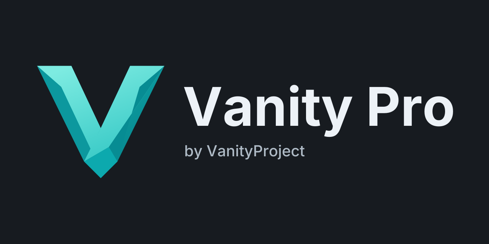

<p align="center">
  
</p>

# Vanity Pro 0.4.1

Vanity Pro generates vanity wallet addresses without a network connection.
It supports 18 mainnet networks and 21 address profiles.
Choose an address prefix or suffix, search with CPU or compatible OpenCL hardware,
then save and verify an encrypted wallet. The project includes a native Windows
desktop application and a command-line application for Windows and Linux.

Search workers receive public data only. Private key operations and encrypted
wallet export stay with the key manager. Sessions can be paused and resumed;
split-key requests let another computer help search using public files.

## Quick start

For a packaged application, follow the [first-run instructions](START-HERE.md).
To compile a GitHub checkout, follow [Build from source](#source-builds) below.
The [desktop guide](docs/GUI.md) covers the complete graphical workflow.

## Packages

Download binaries from [GitHub Releases](https://github.com/VanityProject/vanity-pro/releases).
Choose the ZIP for your platform and extract all files before running the application.

- **Windows desktop:** extract the complete package, then open **VanityPro.exe**. The CLI is a separate download.
- **Windows CLI:** extract the CLI package, then run **vanity.exe** in PowerShell.
- **Linux CLI:** extract the Linux package, then run **vanity** in a terminal.

Read [START-HERE](START-HERE.md) and the [desktop guide](docs/GUI.md).
The application does not require a Python installation or a CUDA Toolkit.
GPU searches require a compatible vendor OpenCL driver. CPU searches do not require OpenCL.
See [hardware coverage](docs/COMPATIBILITY.md).

## Supported profiles

| Network | Address types | Compute | Native recovery format |
|---|---|---|---|
| Ethereum, BNB Smart Chain, Polygon, Arbitrum, Optimism, Base, Avalanche C-Chain | EOA | CPU / OpenCL | Web3 V3 encrypted keystore; optional raw hex |
| TRON | Mainnet account | CPU / OpenCL | Raw private-key hex |
| Bitcoin | Compressed P2PKH, native P2WPKH, key-path P2TR | CPU / OpenCL | Compressed WIF plus checksummed descriptor |
| Litecoin | Compressed P2PKH, native P2WPKH | CPU / OpenCL | Network-specific WIF plus descriptor |
| Dogecoin | Compressed P2PKH | CPU / OpenCL | Network-specific WIF plus descriptor |
| Bitcoin Cash | P2PKH CashAddr | CPU / OpenCL | WIF plus address/type metadata |
| Cosmos Hub | Ordinary secp256k1 account | CPU / OpenCL | Raw private-key hex |
| Warthog | Mainnet account | CPU / OpenCL | Core wallet JSON; Wart Dapp private-key import |
| XRP Ledger | secp256k1 classic account | CPU / OpenCL | XRPL SDK raw keypair; no family seed |
| Solana | Ordinary Ed25519 keypair | CPU | 64-byte keypair JSON |
| Stellar | Ordinary Ed25519 account | CPU | Secret StrKey |
| Algorand | Ordinary Ed25519 account | CPU | SDK Base64 seed + public key |


The seven EVM profiles have the same address derivation. A network label does not change the address for a private key.
Only mainnet profiles are enabled. See [wallet formats and recovery](docs/MULTICHAIN.md) and [Warthog import](docs/WARTHOG.md).

## Search and save a wallet

Select the blockchain and address type. Enter the address prefix. Select **Find address**.
Enter the session password twice, then save the session to start the search.
Automatic mode uses a validated GPU when one is available. CPU mode is also available.
Solana, Stellar, and Algorand use the standard Ed25519 CPU implementation.

After a match, select **Save wallet**. Unlock the session and select an encrypted wallet file.
The application checks the saved wallet before it enables **Copy address**.
A reopened export requires **Do wallet check** before you copy the address.
Native import files are optional and contain an unencrypted private key.

**Keep the session files and their password until you have verified the saved wallet.**
Passwords are not saved in preferences. See [key custody and recovery](docs/SECURITY.md).

## Split-key search

The owner makes a public request and keeps the encrypted private share.
The helper searches the public request and returns a public result.
The owner imports that result, combines the keys, and saves the verified wallet.
All 18 secp256k1 profiles support this file exchange. The three Ed25519 profiles use local searches.
Read the [owner and helper procedure](docs/SPLIT-KEY.md).

## CLI examples

Passwords use hidden prompts. Password command arguments are not supported.
In the Windows CLI package, use:

```powershell
.\vanity.exe chains
.\vanity.exe generate --prefix 000 --backend auto --output .\session
.\vanity.exe resume --session .\session --backend cpu
.\vanity.exe finalize --session .\session --out .\wallet.json
.\vanity.exe verify --wallet .\wallet.json
```

The example searches for an Ethereum address beginning with `0x000`. The prefix
does not include `0x`. `generate` creates an encrypted session and starts the search.
Press **Ctrl+C** to stop, then use `resume` to continue if a match has not been found.
After a match, `finalize` prompts for the session password and a new wallet password;
`verify` checks the saved wallet using its password without printing the private key.
Use a new session directory and wallet filename for each search.

Other supported profiles use the same workflow:

```powershell
.\vanity.exe generate --chain bitcoin --type p2wpkh --prefix bc1qace --backend auto
.\vanity.exe generate --chain solana --prefix SoL --backend cpu
```

When `--output` is omitted, the program prints the generated session directory.
Use that path with `resume` and `finalize`. Linux uses the same commands with `./vanity`.
Use `--help` to list commands or `generate --help` for search options.
Use `--baseline` for the portable reference path when diagnosing a device.

## Hardware selection and estimates

The application selects implementations from the available CPU instructions and GPU capabilities.
It preserves portable scalar CPU and OpenCL 1.2 paths. Optional instructions are checked before use.
Secp256k1 calibration uses a bounded public workload and a private validated cache.
Existing sessions keep their saved candidate strategy when resumed on another device.
The standard Ed25519 implementation does not require a tuning sweep.

To repeat calibration or measure a selected device:

```powershell
.\vanity.exe tune --backend cpu --threads 4
.\vanity.exe tune --backend opencl --devices 0
.\vanity.exe benchmark --backend cpu --threads 4
.\vanity.exe benchmark --chain bitcoin --type p2wpkh --backend opencl --devices 0
```

Rates count evaluated candidates. Transformation branches are included. Rates do not count globally unique private keys.
Each chain has its own workload; an Ethereum rate does not describe another chain.

Time estimates use exact format models where available. Other formats use 32,768 independent public samples made on demand.
Only public samples are retained in memory. Native sample seeds and scalars stay in KeyManager and are cleared after use.
Sample estimates have pointwise 95% intervals. Fewer than 20 matches suppress the estimate.
Zero sampled matches do not establish impossibility. Estimates do not guarantee a completion time.
The GUI makes samples in a background worker.

## Source builds

Install Rust 1.95 or newer with Cargo. Windows builds also require the MSVC C++
build tools and Windows SDK; Linux builds need a native C compiler and build
tools. See the [complete build instructions](docs/BUILD.md).

```sh
git clone https://github.com/VanityProject/vanity-pro.git
cd vanity-pro
```

Windows desktop and CLI:

```powershell
cargo build --release --locked
.\target\release\VanityPro.exe
.\target\release\vanity.exe --help
```

Windows CLI without GUI dependencies:

```powershell
cargo build --release --locked --no-default-features --bin vanity --target-dir target/cli
.\target\cli\release\vanity.exe --help
```

Linux CLI:

```sh
cargo build --release --locked --no-default-features --bin vanity
./target/release/vanity --help
./target/release/vanity self-test --backend cpu
```

Keep `Cargo.lock` and use `--locked`. The first build downloads dependencies;
subsequent builds can use `--offline` after the Cargo cache is populated.
The source tree contains the Rust code, OpenCL kernels, build assets and
configuration, user instructions, and required license notices.

## Instructions

- [First run](START-HERE.md)
- [Desktop application](docs/GUI.md)
- [Wallet formats and recovery](docs/MULTICHAIN.md)
- [Key custody and encrypted files](docs/SECURITY.md)
- [Split-key searches](docs/SPLIT-KEY.md)
- [Warthog wallet import](docs/WARTHOG.md)
- [Hardware compatibility](docs/COMPATIBILITY.md)
- [Build from source](docs/BUILD.md)

## License

[MIT](LICENSE), with the included third-party notices in `licenses/`.
